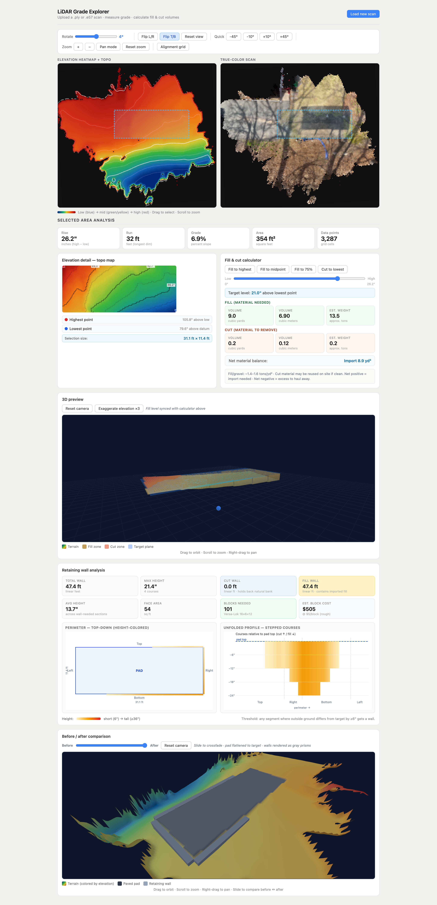

# LiDAR Grade Explorer

A browser-based tool for analyzing ground elevation from LiDAR point cloud scans and planning the earthwork needed to build a flat pad — parking area, patio, building foundation, carport — on a sloped site. Upload a `.ply` or `.e57` scan, draw a rectangle over the intended pad, and the app computes cut/fill volumes, retaining wall requirements, and a before/after 3D visualization of the finished grade.



## What it does

- **Ingests point cloud scans** (`.ply`, `.e57`) from consumer-grade iPhone LiDAR apps (SiteScape, Polycam) or larger-format scanners
- **Auto-detects vertical axis** and downsamples via voxel grid to build a 2D elevation heatmap + true-color image
- **Interactive map view** — rotate, flip, zoom, pan to orient the site to your mental picture; alignment grid and topo contours render in screen space
- **Draggable selection** — pick the rectangular footprint of the pad you want to build
- **Grade + volume calculator** — reports rise, run, grade %, area, and the cubic yards / tons of fill or cut needed to flatten the selection to a chosen target elevation (with a slider to explore fill levels)
- **Retaining wall analysis** — walks the perimeter of the selected rectangle, samples the natural ground just outside each edge, and computes:
  - Linear feet of wall needed (split into *cut* walls — holding back natural bank — and *fill* walls — containing imported fill)
  - Max / average wall height
  - Block count and rough cost estimate (Versa-Lok 16×6×12 by default)
  - Warnings when wall height exceeds thresholds for geogrid reinforcement (≥4 ft) or engineered design + permit (≥6 ft, per typical MA building code)
- **Top-down perimeter diagram** — wall segments color-coded by height
- **Unfolded perimeter profile** — 2D cross-section showing stepped block courses, with the pad top as a reference line: cut walls extend upward from it, fill walls extend downward, so the physical geometry of the finished wall is immediately readable
- **Before/after 3D view** — terrain context with the pad rendered as a charcoal-colored flat surface at target elevation, surrounded by gray retaining wall prisms in the correct position and orientation. A crossfade slider blends from the original terrain to the graded result

## Running locally

```bash
./run.sh
```

Opens at **http://localhost:5050**. First run builds a Python venv (~2 minutes) with `plyfile`, `pye57`, `flask`, `numpy`, `pandas`, `scipy`, and `Pillow`. Subsequent runs start in seconds.

Then drop a `.ply` or `.e57` file onto the page.

## Stack

- **Backend:** Flask serving a single JSON endpoint per scan — no database, no session state
- **Point cloud processing:** `plyfile` + `pye57` for reading; pure-NumPy voxel downsampling and pandas groupby for building the 2D elevation grid (no `open3d` dependency — keeps install lightweight and portable)
- **Frontend:** Vanilla JS in a single `static/index.html` file, rendered with inline CSS. No React, no bundler, no TypeScript.
- **3D:** Three.js r158 loaded via unpkg importmap
- **Overlay rendering:** HTML canvas drawn in screen space, so topo contours and selection boxes stay aligned to the user's view regardless of map rotation or zoom

## Architecture notes

- **The scan is processed once** on upload: read → voxel downsample → ground-filter → 2D elevation grid at 0.10 m resolution → gaussian smooth → PNG heatmap + true-color image. Grid data returns as a flat JSON array (`-1` for no-data cells). All interactive math — selection, grade, volume, wall computation, 3D mesh — runs client-side from that grid.
- **Retaining wall computation walks the user's drawn rectangle**, not the grid-axis-aligned bounding box of selected cells. Screen-space corners are projected into grid space via the inverse of the view transform; each edge is walked at cell-size steps; ground elevation is sampled one cell outside the edge perpendicular to the edge direction. This keeps the wall prisms aligned to the actual pad regardless of map rotation.
- **The before/after 3D scene** builds two terrain meshes from the same context region: `before` uses raw elevations, `after` clamps cells inside the drawn rectangle to target elevation and paints them a distinct pad color. Wall prisms are placed per-segment with correct rotation matching the edge direction and shifted outward so the inner wall face sits on the pad boundary. Material opacity is driven directly by a slider for smooth crossfade — no scene rebuild on drag.
- **No framework** was deliberate — the app has ~1500 lines of JS and a single Flask handler. React/TypeScript would add more ceremony than value at this scale, and the single-file frontend makes it trivial to clone and run.

## Limitations

- Processing time: ~15–20 seconds for a 24M-point residential-scale scan at 0.03 m voxel / 0.10 m grid resolution. No persistent cache — re-uploading the same scan reprocesses from scratch.
- `pye57` only reads scan 0 of a multi-scan E57 file.
- Wall cost and engineering thresholds use New England / Massachusetts assumptions. Adjust `BLOCK_SPEC` in `static/index.html` for other block types.
- No touch support for selection / pan.
- All grade and volume calculations assume compacted fill density (~1.5 tons/yd³). Loose material will be ~15% higher volume.

## License

MIT.
